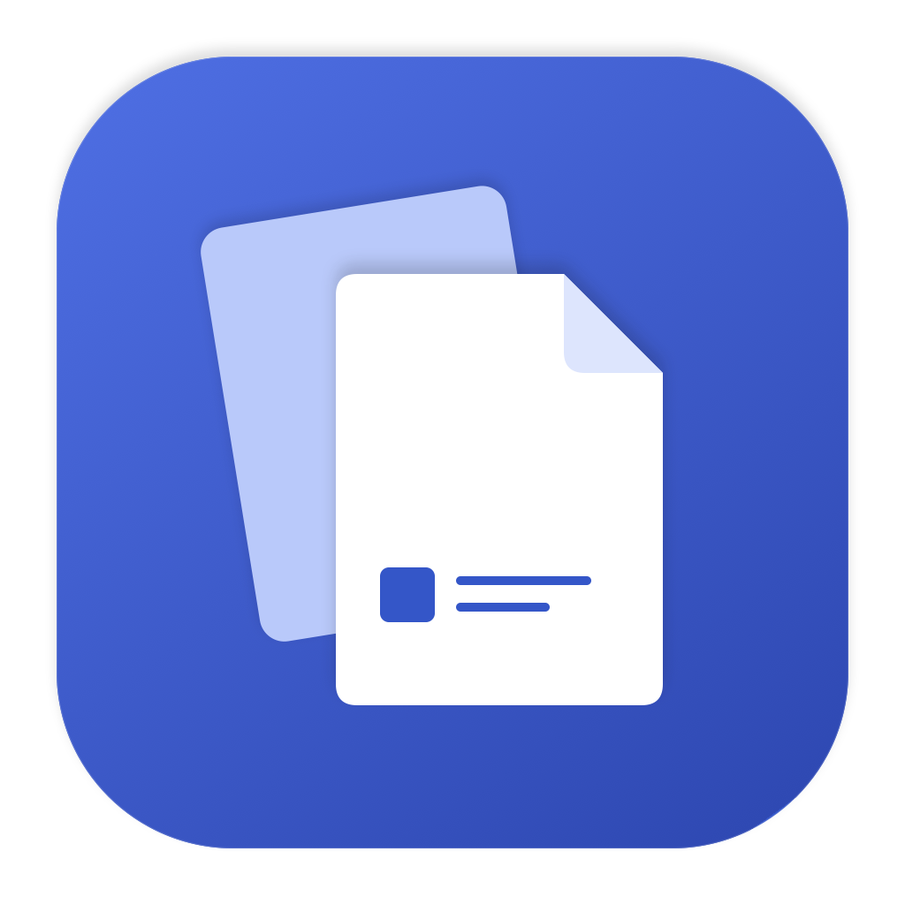
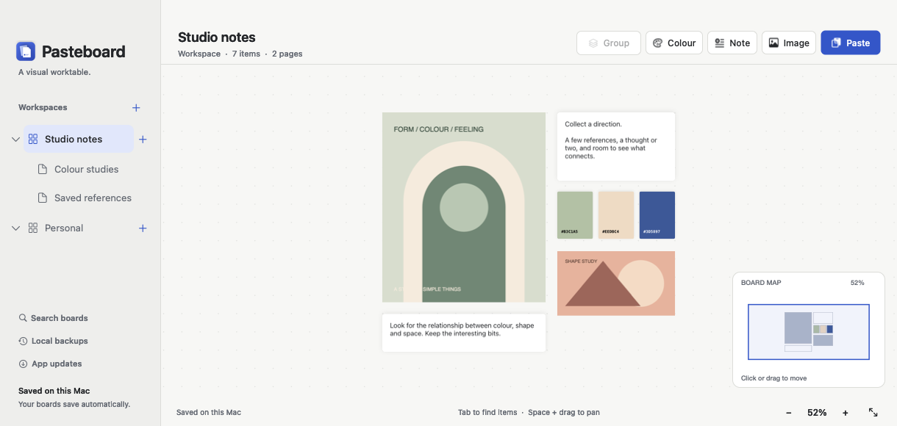

<p align="center">
  
</p>

<h1 align="center">Pasteboard</h1>
<p align="center">A visual worktable for Mac.</p>
<p align="center">
  <a href="https://github.com/leolunelove/pasteboard/releases/latest/download/Pasteboard-Mac.zip"><strong>Download for Mac</strong></a>
  &nbsp; · &nbsp;
  <a href="https://pasteboard.leolunelove.chatgpt.site/">Website</a>
  &nbsp; · &nbsp;
  <a href="https://github.com/leolunelove/pasteboard/releases">Release notes</a>
</p>

<p align="center">Apple Silicon · macOS 13 or later · Early preview</p>



Paste images, notes and colours onto an infinite board. Move things around, collect a few references, and see what comes together.

> **Work in progress.** Pasteboard is an early preview. Expect rough edges, and keep a separate backup of important boards. The Mac download is locally signed and has not yet been notarized by Apple; macOS may prevent it from opening.

## Get started

1. [Download the latest Mac ZIP](https://github.com/leolunelove/pasteboard/releases/latest/download/Pasteboard-Mac.zip).
2. Unzip it and move **Pasteboard.app** to a writable Applications folder.
3. Open the app, then press **⌘V** to paste an image or some text.

No account is needed in the app. Boards and images stay on your Mac. The website introduces the app; it is not a browser version of the board.

## A little room for everything

- **Images and text:** paste or drop images, transparent PNGs, SVG artwork and notes. Add colour swatches with visible HEX values.
- **An infinite board:** pan, zoom, find items with Tab, or jump around using the minimap.
- **Arrange together:** move and resize groups in proportion, with alignment and equal-spacing guides.
- **Keep things organised:** workspaces, named pages, drag between pages, search and locking.
- **Refine and share:** non-destructive image cropping, source links, and PNG or PDF export.
- **Keep a copy:** local autosave, automatic backup checkpoints, and portable board exports.

## Update from the app

Open **Pasteboard → Check for Updates…**, or choose **App updates** in the sidebar. When a newer GitHub release is available, click **Update and Relaunch**.

The app downloads the release, verifies its SHA-256 checksum and app identity, saves your boards, and relaunches into the new version. Failed verification leaves the current app in place. If the installer cannot launch the replacement, it restores the previous app. The app needs to be in a writable location.

Checking GitHub requires an internet connection. Checks are initiated from the update screen; updates do not install silently. Older versions that only support the local build channel need this GitHub-enabled version installed once.

## Handy keys

| Action | Shortcut |
| --- | --- |
| Paste | ⌘V |
| Add a note / colour swatch | T / S |
| Pan | Space + drag, or two-finger scroll |
| Zoom | Pinch, or ⌘+ / ⌘− |
| Fit the board | ⌘0 |
| Next / previous item or group | Tab / Shift-Tab |
| Group / ungroup | ⌘G / ⇧⌘G |
| Search | ⌘F |
| Undo / redo | ⌘Z / ⇧⌘Z |

## Build locally

Requires macOS 13 or later and Apple’s Xcode Command Line Tools. The included release targets Apple Silicon. A local build uses the Mac’s current architecture.

```sh
./mac/build.sh
open mac/Pasteboard.app
```

There are no third-party runtime dependencies. The app uses Swift, AppKit and native macOS frameworks. `mac/Source/` contains the application and its native regression checks. The app’s **Help → Run Self-Check** command exercises temporary boards.

After building, run `./scripts/test-updates.sh` to verify remote-update metadata, failed downloads, checksums, archive restrictions, app validation, installation and rollback using disposable app copies.

## Project layout

```text
mac/         Native Mac app, build script and release notes
website/     Static website source
assets/      App icon and demonstration board
scripts/     Release packaging helper
```

Release ZIPs live in [GitHub Releases](https://github.com/leolunelove/pasteboard/releases), rather than the source tree. The demonstration board is sample content. No personal boards, imported user images, local backups or credentials are included here.

To prepare a release after building, run `python3 scripts/package-release.py`. Publish the generated ZIP and update manifest together in a GitHub release with a matching `vX.Y.Z` tag, marked as the latest release. See [release instructions](scripts/RELEASING.md).
